<a name="top"></a>

<h1 align="center">Top Scholar Engineers · WRO 2026 Future Engineers</h1>

<p align="center">
  <b>A behaviour-cloning self-driving car with a deterministic sensor-fusion safety net</b><br>
  Raspberry Pi 5 · Raspberry Pi Pico 2 · 2 × DYNAMIXEL XL330 · 6 × ToF · BNO085 · DonkeyCar CNN
</p>

<p align="center">
  
  
  
  
  
  
  
</p>

<p align="center">
  <a href="#1-overview">Overview</a> ·
  <a href="#3-vehicle-and-videos">Vehicle</a> ·
  <a href="#4-mobility-management">Mobility</a> ·
  <a href="#5-power-and-sense-management">Power &amp; Sense</a> ·
  <a href="#6-obstacle-management">Obstacle Management</a> ·
  <a href="#7-training-pipeline">Training</a> ·
  <a href="#9-engineering-journal">Journal</a> ·
  <a href="#10-build-and-reproduce">Build</a>
</p>

<p align="center">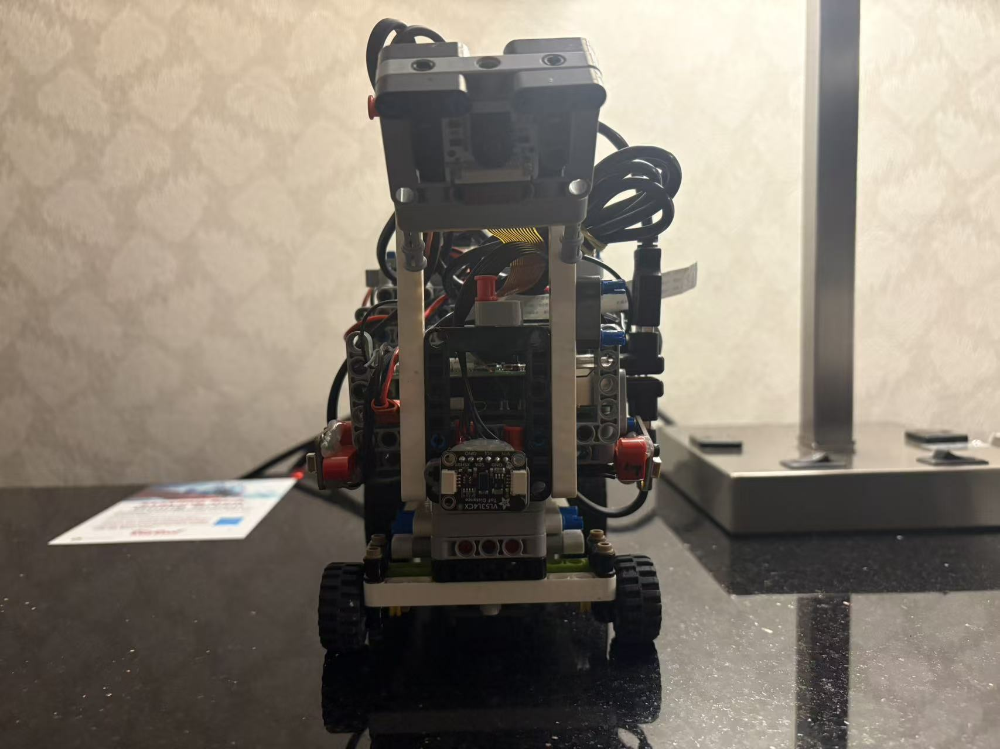</p>

> [!NOTE]
> **Documentation status (2026-10-31).** All code, diagrams and data charts in this repository
> come from our actual source code and recorded data. Items marked **TODO** (vehicle photos,
> chassis dimensions, power system, test results) are waiting for measurements on the
> physical car. We do not publish estimated numbers. The full list is in
> [`docs/open-items.md`](docs/open-items.md).

---

## Table of Contents

1. [Overview](#1-overview)
2. [Team](#2-team)
3. [Vehicle and Videos](#3-vehicle-and-videos)
4. [Mobility Management](#4-mobility-management)
   [4.1 Drive](#41-drive) · [4.2 Steering](#42-steering) · [4.3 Chassis](#43-chassis) · [4.4 Motor control and odometry](#44-motor-control-and-odometry)
5. [Power and Sense Management](#5-power-and-sense-management)
   [5.1 Architecture](#51-system-architecture) · [5.2 Sensors](#52-sensors) · [5.3 Sensor hub](#53-pico-2-sensor-hub) · [5.4 Wiring](#54-wiring) · [5.5 Power](#55-power-budget)
6. [Obstacle Management](#6-obstacle-management)
   [6.1 Strategy](#61-strategy) · [6.2 Open Challenge](#62-open-challenge) · [6.3 Obstacle Challenge](#63-obstacle-challenge) · [6.4 Wall following](#64-wall-following-cascade-control) · [6.5 Heading re-calibration](#65-heading-re-calibration-against-a-wall) · [6.6 Parking](#66-parallel-parking) · [6.7 AI pilot](#67-ai-pilot)
7. [Training Pipeline](#7-training-pipeline)
8. [Testing and Validation](#8-testing-and-validation)
9. [Engineering Journal](#9-engineering-journal)
10. [Build and Reproduce](#10-build-and-reproduce)
11. [Repository Structure](#11-repository-structure)
12. [Lessons Learned and Next Steps](#12-lessons-learned-and-next-steps)
13. [License and Acknowledgements](#13-license-and-acknowledgements)

---

## 1. Overview

Our vehicle combines two kinds of control. A **convolutional neural network**, trained by
behaviour cloning on more than 200,000 human-driven frames, drives the laps: it handles
the randomised walls and the red and green pillars, which are hard to describe with
hand-written rules. **Deterministic, sensor-based primitives** take over wherever precision
matters more than adaptability: leaving the parking lot, counting laps, re-zeroing the
heading against a wall, following the wall and parallel parking.

<table>
<tr>
<td width="50%" valign="top">

**Vehicle at a glance**

| | |
|---|---|
| Main computer | Raspberry Pi 5 (Python 3, DonkeyCar) |
| Sensor co-processor | Raspberry Pi Pico 2 (RP2350, MicroPython, dual-core) |
| Drive | DYNAMIXEL XL330-M288-T, velocity mode, 1 : 3 gear-up |
| Steering | DYNAMIXEL XL330-M288-T, position mode, ±40° |
| Vision | CSI camera, 320 × 240 → 160 × 120, locked exposure |
| Distance | 6 × ToF (1 × VL53L4CX, 5 × VL53L4CD) |
| Heading | BNO085 (UART-RVC), unwrapped continuous yaw |
| Floor colour | TCS34725 with LED |
| Size / mass | **TODO** measure |

</td>
<td width="50%" valign="top">

**What is new in 2026** (compared with our [2025 World Finals car](https://github.com/TopWRO/Top_WRO-2025-documentation))

| 2025 | 2026 |
|---|---|
| LEGO motors on a Build HAT | **DYNAMIXEL XL330** smart servos over one TTL bus |
| Sensors read by the Pi | **Pico 2 sensor hub**, dual-core, 20 Hz stream |
| 4 × VL53L0X | **6 × VL53L4CD/CX**, with paired side sensors |
| Sense HAT gyro + ZUPT | **BNO085** + wall-based heading re-calibration |
| Many threads per port | **one I/O thread** owns every port |
| Monolithic scripts | **core library + short run scripts** |
| ~200k training frames | **203,732 frames**, separate CW/CCW models |

</td>
</tr>
</table>

<p align="center">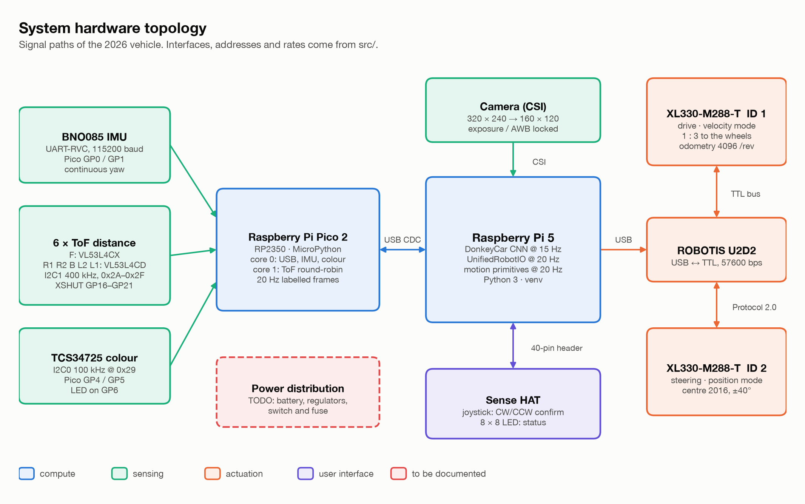</p>

<p align="right"><a href="#top">↑ back to top</a></p>

## 2. Team

<p align="center"></p>

| Member | Role |
|---|---|
| **TODO** | **TODO** |
| **TODO** | **TODO** |
| **TODO** | **TODO** |
| **TODO** (coach) | **TODO** |

Team *Top Scholar Engineers* (GitHub organisation **TopWRO**). In the 2025 season we won the
**US National Championship (July 2025)** and competed at the **WRO World Finals in Singapore
(November 2025)**. That season is documented in
[Top_WRO-2025-documentation](https://github.com/TopWRO/Top_WRO-2025-documentation). The
fun photo required by the rules is [`t-photos/funny.jpg`](t-photos/funny.jpg).

<p align="right"><a href="#top">↑ back to top</a></p>

## 3. Vehicle and Videos

<table>
  <tr>
    <td align="center"><b>Front</b><br></td>
    <td align="center"><b>Back</b><br>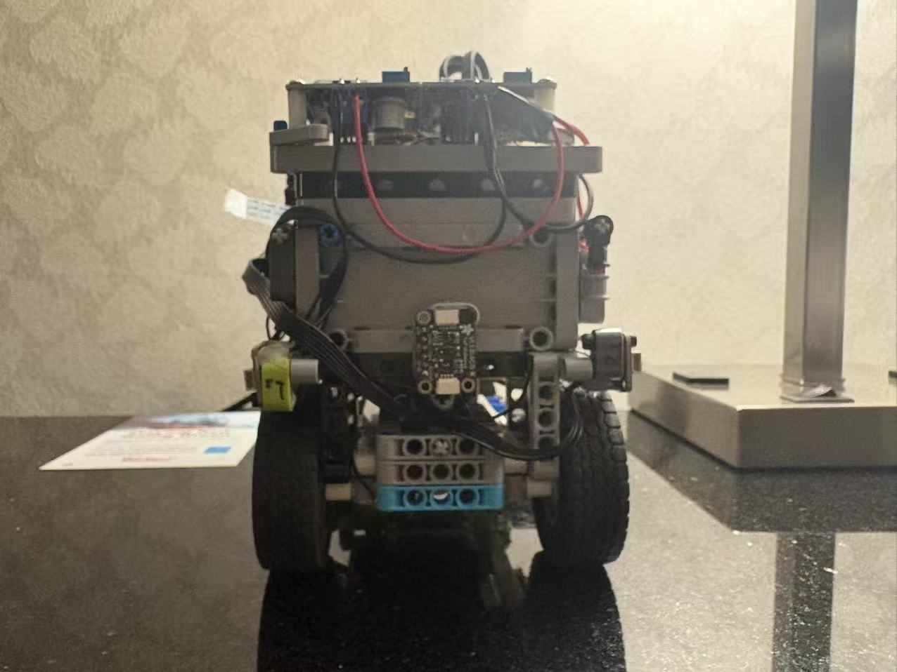</td>
    <td align="center"><b>Top</b><br>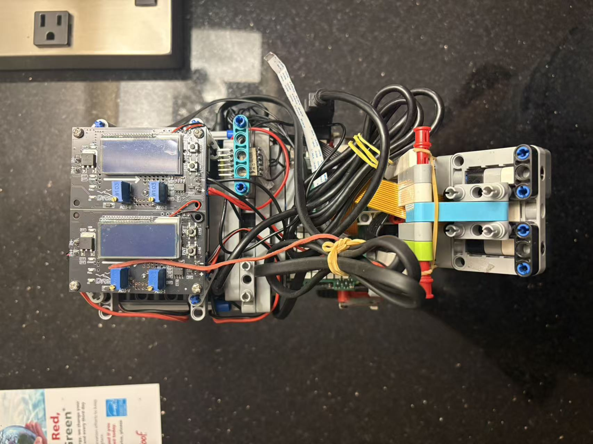</td>
  </tr>
  <tr>
    <td align="center"><b>Left</b><br>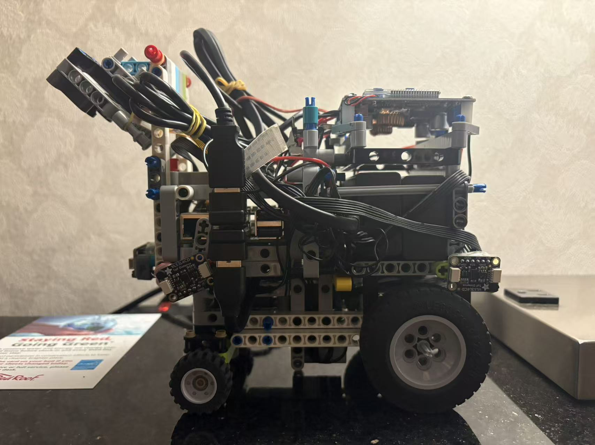</td>
    <td align="center"><b>Right</b><br>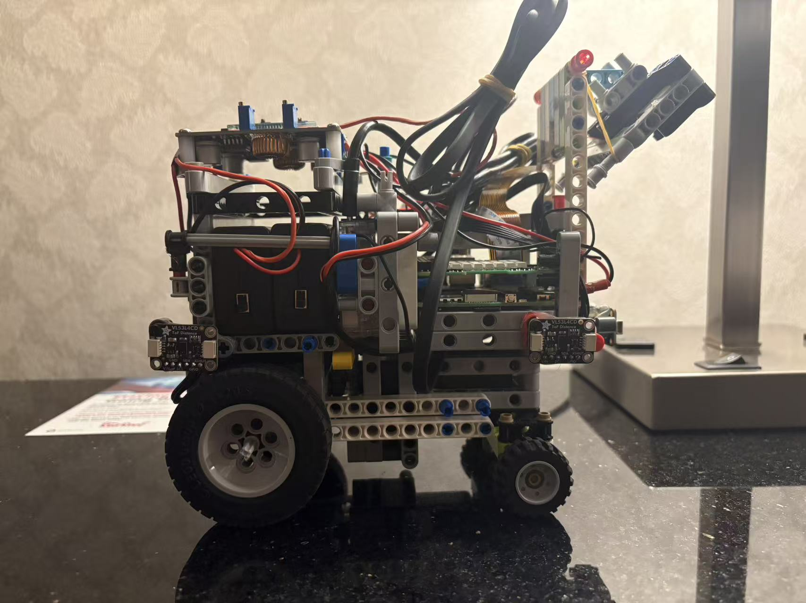</td>
    <td align="center"><b>Bottom</b><br></td>
  </tr>
</table>

| Run | Video |
|---|---|
| Open Challenge | **TODO**, link in [`video/video.md`](video/video.md) |
| Obstacle Challenge with parking | **TODO**, link in [`video/video.md`](video/video.md) |

<p align="right"><a href="#top">↑ back to top</a></p>

## 4. Mobility Management

### 4.1 Drive

<table>
<tr>
<td width="260" align="center">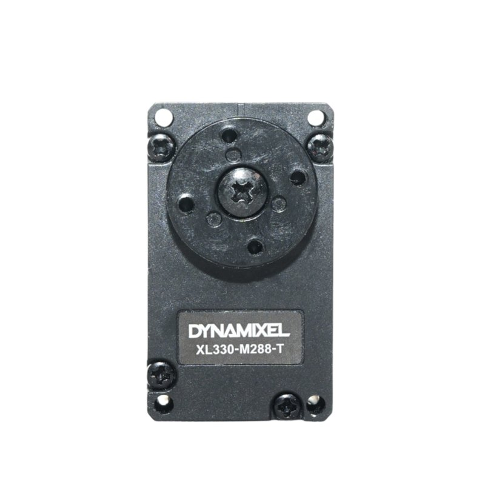</td>
<td>

**ROBOTIS DYNAMIXEL XL330-M288-T, ID 1, velocity mode**

- Operating voltage 3.7 to 6.0 V (5.0 V recommended); 288.35 : 1 gearhead
- 12-bit contactless absolute encoder, 4096 counts per revolution, multi-turn position
- TTL half-duplex bus, DYNAMIXEL Protocol 2.0, 57,600 bps on our car
- Velocity commands in units of 0.229 rpm; the software caps the target at 100 rpm
- Reports a hardware-error register (overload, overheating, voltage, encoder)
- [e-Manual](https://emanual.robotis.com/docs/en/dxl/x/xl330-m288/)

</td>
</tr>
</table>

**Why we chose it.** In 2025 we drove with LEGO motors through a Build HAT. Moving to
DYNAMIXEL gives us four things. First, *closed-loop velocity control inside the motor*, so
the commanded speed holds when the battery voltage or the load changes. Second, an
*absolute multi-turn encoder* that we use as odometry. Third, *one shared bus* for drive and
steering. Fourth, *self-diagnosis*: our start-up routine reads the Hardware Error Status
register and reboots and reconfigures a faulted motor before the run. The trade-off is
torque: the XL330 is a small servo, so the drive is geared **up** 1 : 3, with one motor
revolution giving three wheel revolutions.

**From command to wheel speed.** A throttle command $v_{cmd}\in[-1,1]$ is converted in
`UnifiedRobotIO._write_throttle_immediate()`:

```math
n_\text{motor} = v_\text{cmd}\cdot 100\ \text{rpm},\qquad
\text{GoalVelocity} = \left\lfloor \frac{n_\text{motor}}{0.229\ \text{rpm}} \right\rfloor ,\qquad
n_\text{wheel} = 3\,n_\text{motor},\qquad
v_\text{ground} = \frac{\pi D\,n_\text{wheel}}{60}
```

Here $D$ is the wheel diameter (**TODO** measure). The AI limits its own throttle to
$0.35\cdot v_{cmd}$ in the Obstacle Challenge and $0.70\cdot v_{cmd}$ in the Open Challenge.
That corresponds to 35 and 70 rpm at the motor.

### 4.2 Steering

**DYNAMIXEL XL330-M288-T, ID 2, position mode.** It turns the front wheels through a
linkage (**TODO**: linkage type, Ackermann or parallel, and the measured wheel angle at full
command). The software maps a steering command $u\in[-1,1]$ to a goal position:

```math
\delta = 40^\circ\cdot \mathrm{clip}\!\left(1.1\,u,\,-1,\,1\right),\qquad
p_\text{goal} = 2016 + \delta\cdot\frac{4096}{360^\circ}
```

`2016` is the calibrated straight-ahead position (`DXL_STEER_CENTER_POS`) and `1.1` is the
global steering gain `ANGLE_OFFSET`. A goal position is only re-sent when it changes, which
keeps the shared bus free for odometry reads. For a bicycle model with wheelbase $L$, the
turning radius is $R = L/\tan\delta$ (**TODO**: insert the measured $L$ and the minimum radius).

<p align="center">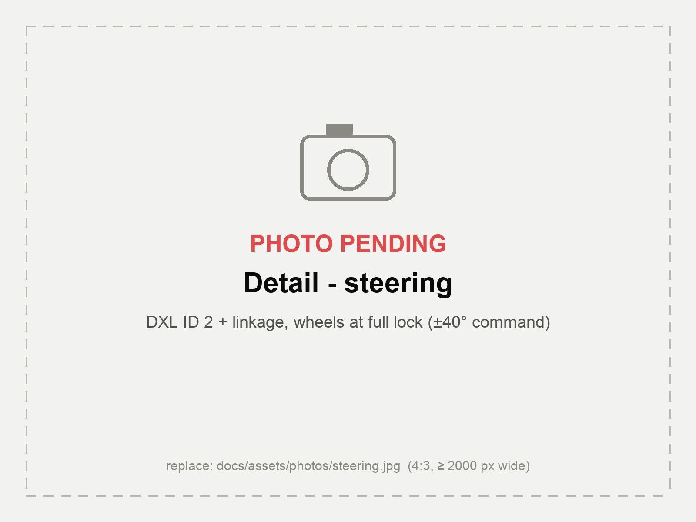</p>

### 4.3 Chassis

| Dimension | Value |
|---|---|
| Length × width × height | **TODO** |
| Wheelbase / track | **TODO** |
| Mass | **TODO** |
| Construction | **TODO** (LEGO Technic / 3D-printed parts; CAD in [`models/`](models)) |

<p align="center">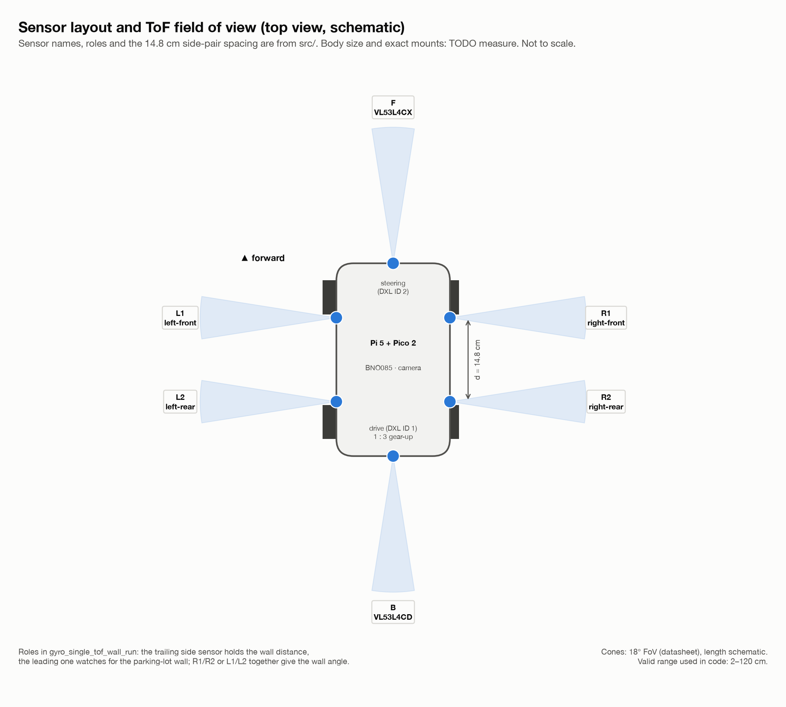</p>

The sensor layout follows directly from the algorithms. A **side pair** on each side (R1/R2
and L1/L2, 14.8 cm apart) measures the wall *angle* as well as the distance. **Front and
rear** sensors (F, B) give stopping distances for forward and reverse manoeuvres.

<table>
  <tr>
    <td align="center"><b>Drivetrain</b><br>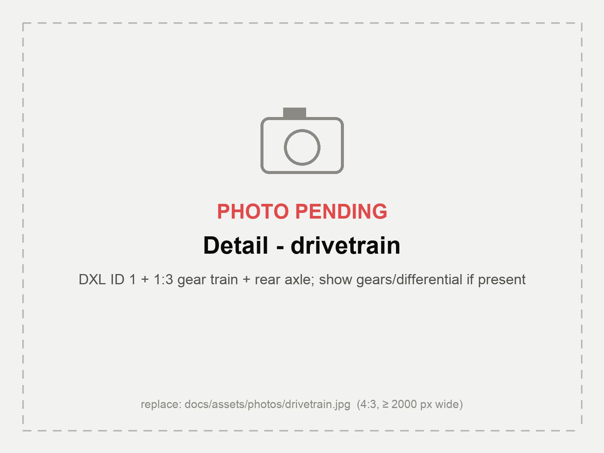</td>
    <td align="center"><b>Side ToF pair</b><br>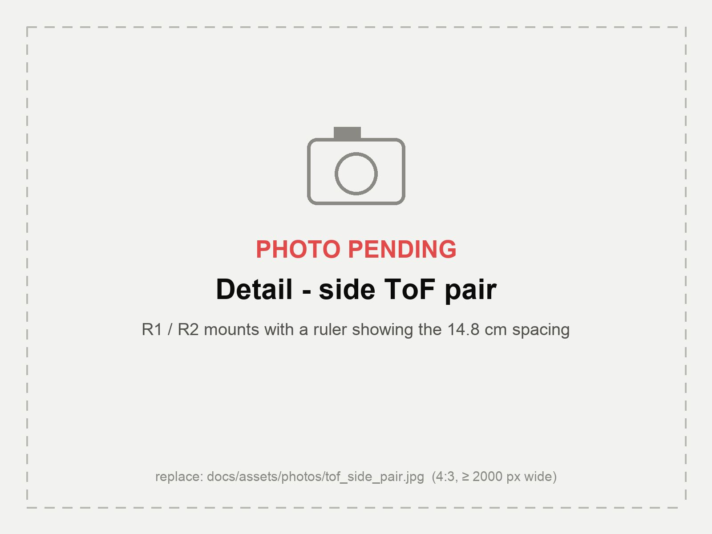</td>
    <td align="center"><b>Camera mount</b><br>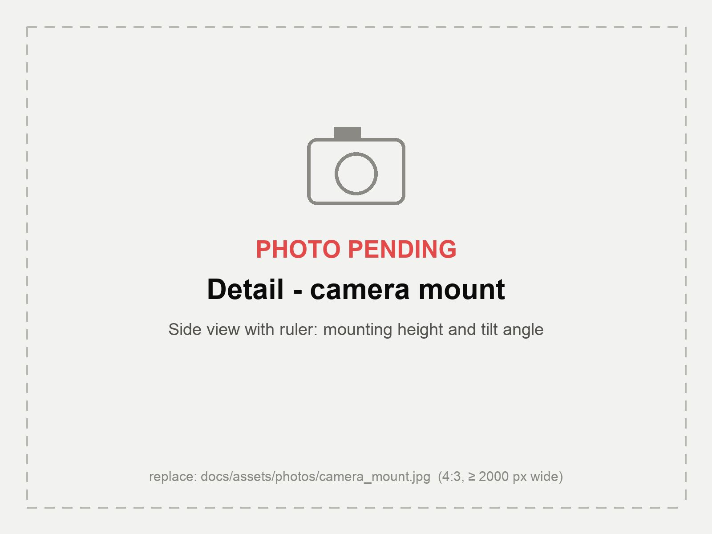</td>
  </tr>
</table>

### 4.4 Motor control and odometry

A dedicated thread, `UnifiedRobotIO`, is the only code that talks to the U2D2. Every 50 ms it
writes the newest steering target, writes the newest velocity target and reads the drive
motor's multi-turn position. The position increments are integrated into
**wheel-equivalent degrees**, the distance unit used by every motion primitive:

```math
\theta_\text{wheel} = 3\cdot\frac{360^\circ}{4096}\sum_k \Delta p_k ,
\qquad |\Delta p_k| < 10^5 \ \text{(glitch rejection)}
```

so `run_distance = 3000` means 3000° of wheel rotation, or $\tfrac{3000}{360}\pi D$ of travel.

<p align="right"><a href="#top">↑ back to top</a></p>

## 5. Power and Sense Management

### 5.1 System architecture

The Raspberry Pi 5 runs everything that needs computing power: camera, CNN inference and
motion control. All low-level sensor timing runs on a **Raspberry Pi Pico 2**, which streams
one complete sensor frame every 50 ms over USB. This keeps the Pi's Python threads away from
time-critical I2C and UART work. See [`docs/software.md`](docs/software.md) for the thread
model.

<table>
  <tr>
    <td align="center"><b>Raspberry Pi 5</b><br>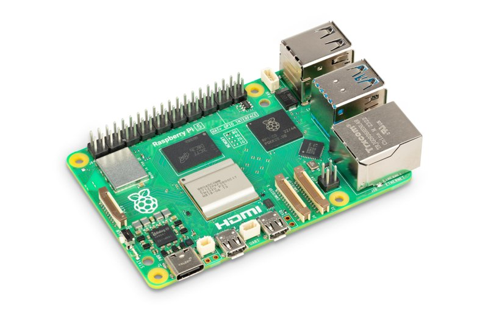</td>
    <td align="center"><b>Pico 2 sensor hub</b><br>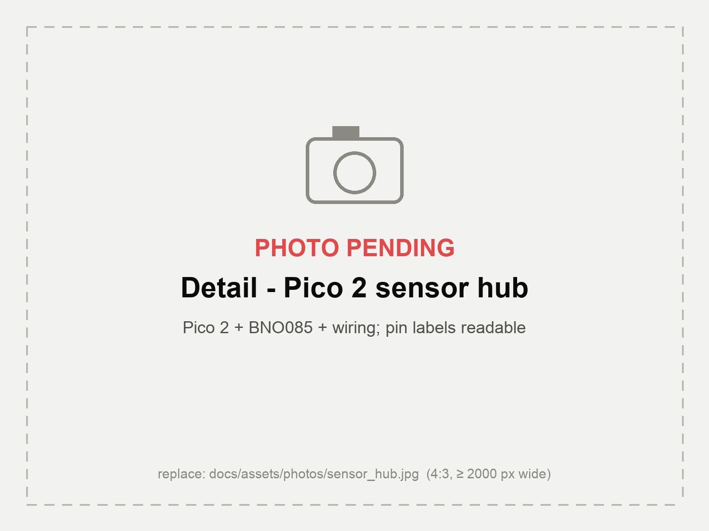</td>
    <td align="center"><b>Sense HAT (start-up UI)</b><br>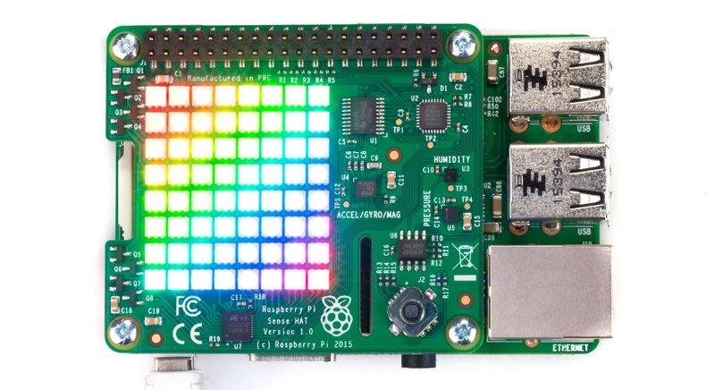</td>
  </tr>
</table>

<p align="center">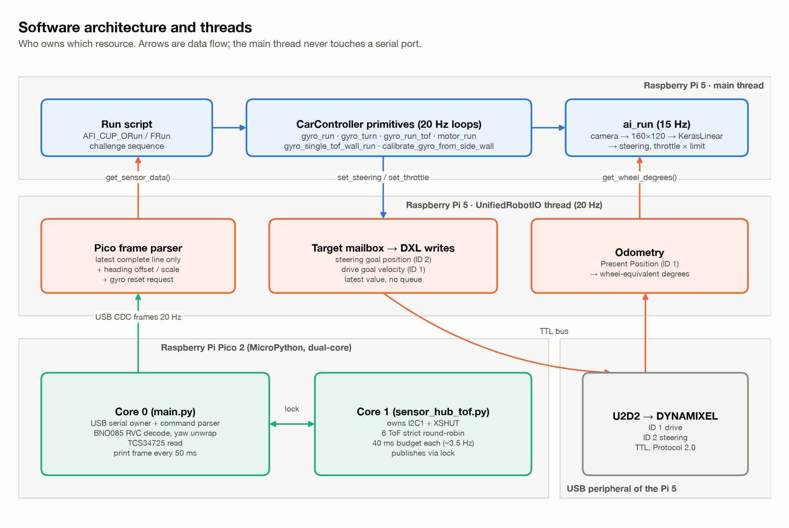</p>

### 5.2 Sensors

<table>
<tr><th>Sensor</th><th>Interface</th><th>Configuration in our code</th><th>Used for</th></tr>
<tr><td><b>Camera</b> (CSI, model <b>TODO</b>)</td><td>CSI → Pi 5</td>
<td>320 × 240 @ 30 fps, resized to 160 × 120; AWB off with gains (1.2, 1.5), ISO 100, shutter 15 ms, exposure locked</td>
<td>CNN input (laps, pillars)</td></tr>
<tr><td><b>VL53L4CX</b> ToF (F)</td><td>I2C1 @ 0x2A, XSHUT GP20</td>
<td>40 ms timing budget, σ ≤ 45 mm, min. signal 0.01 MCPS</td><td>front stop distance</td></tr>
<tr><td><b>VL53L4CD</b> ToF × 5 (R1 R2 B L2 L1)</td><td>I2C1 @ 0x2B–0x2F, XSHUT GP21/18/19/16/17</td>
<td>40 ms budget, σ ≤ 45 mm, min. signal 0.02 MCPS; valid range status 4/7/9</td><td>wall distance and angle, parking detection, rear stop</td></tr>
<tr><td><b>BNO085</b> IMU</td><td>UART0 RVC, 115200 baud, GP1</td>
<td>19-byte RVC frames, checksum checked, yaw unwrapped to a continuous angle</td><td>heading hold, turns, lap counting</td></tr>
<tr><td><b>TCS34725</b> colour</td><td>I2C0 @ 0x29, GP4/GP5, LED GP6</td>
<td>24 ms integration, 4× gain, raw R/G/B/C</td><td>streamed for floor-line detection (not yet used by the run scripts)</td></tr>
<tr><td><b>Sense HAT</b></td><td>Pi 5 40-pin header</td>
<td>joystick + 8 × 8 LED matrix</td><td>CW/CCW confirmation and start-up status</td></tr>
</table>

**Why ToF and not LiDAR.** Six single-zone ToF sensors cost a fraction of a 2D LiDAR, weigh
almost nothing and return calibrated distances with no point-cloud processing. Their weakness
is the narrow field of view (18°) and a refresh rate of about 3.7 Hz each, because they range
one after another. We designed the controllers to cope with this: the readings are low-pass
filtered, a short dropout holds the last valid correction, and the gyro, not the ToF, closes
the fast inner loop.

**Heading signal chain.** The BNO085 computes its orientation on-chip and, in UART-RVC mode,
streams it as fixed-format frames. The Pico unwraps the yaw ($\psi_{k}=\psi_{k-1}+((y_k-y_{k-1}+180)\bmod 360-180)$),
so the angle keeps counting past ±180°. On the Pi, the sign is flipped to make clockwise
positive, and a small asymmetric scale and the wall-calibrated offset are applied:

```math
\tilde\psi = -\psi_\text{Pico},\qquad
\psi = k(\tilde\psi)\,\tilde\psi + \psi_\text{off},\qquad
k = \begin{cases}1.00 & \tilde\psi \ge 0\ \text{(CW)}\\ 1.01 & \tilde\psi < 0\ \text{(CCW)}\end{cases}
```

### 5.3 Pico 2 sensor hub

<p align="center">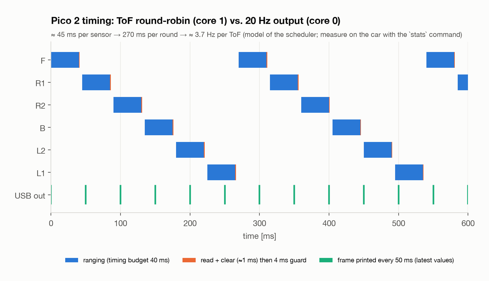</p>

- **Core 0** owns USB. It reads commands, decodes the IMU, reads the colour sensor and prints
  one labelled frame every 50 ms.
- **Core 1** owns I2C1 and the six XSHUT lines. At start-up it wakes the sensors one at a
  time at the default address `0x29` and moves each to its own address (`0x2A`–`0x2F`). After
  that it ranges them **strictly round-robin**. Only one sensor emits at a time, which rules
  out optical cross-talk between neighbours.
- The cores share data only through a short lock-protected mailbox. No I/O happens while the
  lock is held.

Refresh rate per ToF, from the scheduler constants (timing budget $T_b$ = 40 ms, read ≈ 1 ms,
switch guard 4 ms):

```math
f_\text{ToF} \approx \frac{1000\ \text{ms}}{6\,(T_b + T_\text{read} + T_\text{guard})} = \frac{1000}{6\cdot 45} \approx 3.7\ \text{Hz}
```

The budgets can be changed at run time (`R1:20`, `B:0` …). The `stats` command measures the
real rates on the car.

Frame format and commands: [`docs/software.md` § Serial protocol](docs/software.md#2-serial-protocol).

### 5.4 Wiring

<p align="center">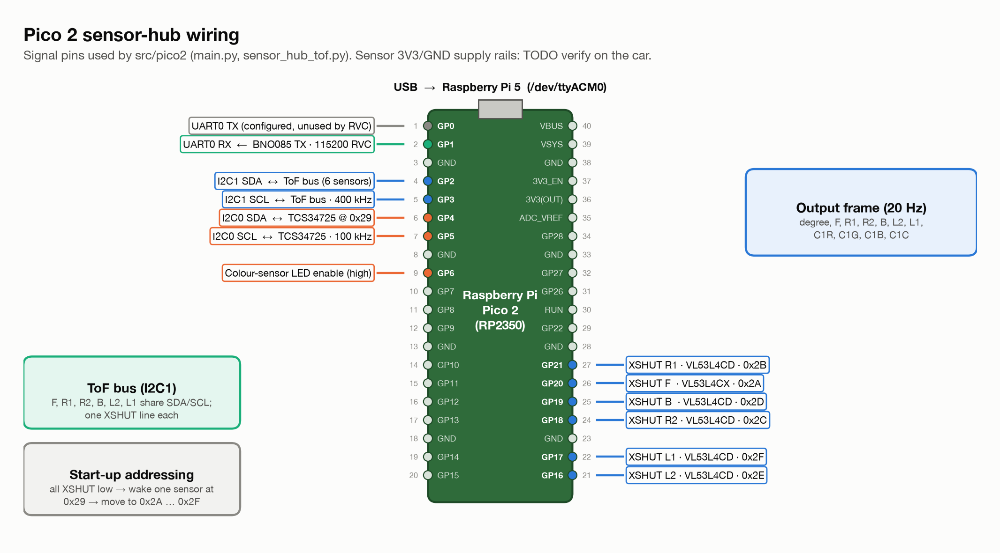</p>

| Link | From → to | Physical layer |
|---|---|---|
| Sensor stream | Pico 2 → Pi 5 (`/dev/ttyACM0`) | USB CDC |
| Motor bus | Pi 5 → U2D2 (`/dev/ttyUSB0`) → XL330 ID 1, ID 2 | USB → TTL, Protocol 2.0, 57,600 bps |
| Camera | camera → Pi 5 | CSI ribbon |
| User interface | Sense HAT → Pi 5 | 40-pin header |
| Power distribution | battery → Pi 5 / motors / Pico | **TODO** |

All diagrams are also available as SVG in [`schemes/`](schemes).

### 5.5 Power budget

> [!IMPORTANT]
> The power system (battery, regulators, switch, fuse) has not been measured yet. The
> table below will be filled with **measured** currents. We will not publish datasheet
> guesses.

| Consumer | Supply | Typical current | Peak current | Source |
|---|---|---|---|---|
| Raspberry Pi 5 + camera + Sense HAT | 5 V | TODO | TODO | measure |
| Pico 2 + 6 ToF + BNO085 + TCS34725 | 5 V USB → 3.3 V | TODO | TODO | measure |
| XL330 ID 1 (drive) | TODO | TODO | TODO | measure |
| XL330 ID 2 (steering) | TODO | TODO | TODO | measure |

Once the table is complete, the runtime follows from the battery capacity $C$, voltage
$V_\text{bat}$ and regulator efficiency $\eta$:

```math
t_\text{run} = \frac{C\cdot V_\text{bat}\cdot\eta}{\sum_i V_i I_i}
```

<p align="right"><a href="#top">↑ back to top</a></p>

## 6. Obstacle Management

### 6.1 Strategy

| Phase | Controller | Why |
|---|---|---|
| Direction detection | ToF L1 vs. R1 + operator confirmation | the inner wall is closer on the turning side |
| Unparking | gyro-held S-manoeuvre | the same in every run, so it does not need learning |
| Three laps | **CNN (behaviour cloning)** | random walls and pillar layouts are hard to hand-code |
| Lap counting | continuous heading $\lvert\psi\rvert \ge 1080^\circ$ | does not depend on detecting floor lines |
| Drift removal | heading re-calibration against straight walls | errors accumulate over three laps |
| Wall run + parking | cascade ToF/gyro control + scripted manoeuvre | needs centimetre precision |

**Direction detection.** At the start the car averages the last five L1 and R1 readings. If
the right wall is closer, the course runs counter-clockwise; otherwise clockwise. The
suggestion appears on the Sense HAT LED matrix (pixel (0, 7) for CCW, pixel (7, 7) for CW). Holding
the joystick toggles the choice every second, and releasing it confirms and starts the run.
The detection is automatic, but a human can override it before the run starts.

### 6.2 Open Challenge

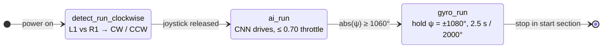

The CNN drives until the heading has turned 1060°, just before the end of lap 3. A short
gyro-held straight at exactly ±1080° then brings the car to rest in the start section. The
stop does not depend on detecting a floor line.

### 6.3 Obstacle Challenge

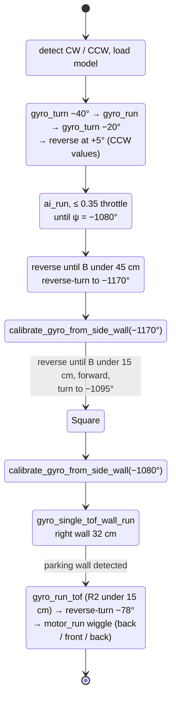

The CW program is an exact mirror of the CCW one. Right becomes left, R2 becomes L2, and
every steering command and heading target changes sign. Forward/backward meaning and the
front/back stop sensors stay the same. Mirroring the code, rather than tuning each direction
on its own, means one tuning pass covers both directions.

### 6.4 Wall following: cascade control

<p align="center">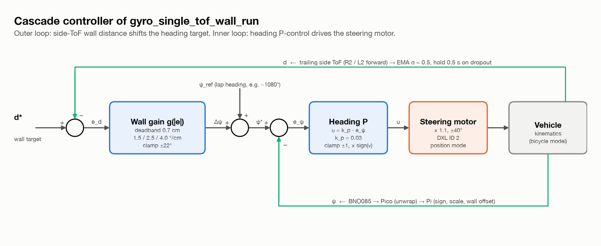</p>

The ToF sensors never steer the car directly; they only **move the heading target**. The
gyro loop, which updates far faster than the ToFs, does the steering. A noisy or missing ToF
reading can therefore only bend the target heading by a bounded amount. It cannot make the
car swerve.

**Outer loop: wall distance → heading offset.** The ToF behind the car in its direction of
travel holds the wall distance $d$ (R2 when driving forward along the right wall, R1 when
reversing). Its reading is smoothed and compared with the target $d^{\ast}$:

```math
\hat d_k = 0.5\,d_k + 0.5\,\hat d_{k-1},\qquad e_d = d^{\ast} - \hat d_k
```

```math
\Delta\psi = \mathrm{clip}\!\big(e_d\, g(|e_d|)\, s_\text{side}\, s_\text{motion},\ \pm 22^\circ\big),
\qquad
g(|e|) = \begin{cases}
0 & |e| \le 0.7\ \text{cm (deadband)}\\
1.5 \;/\; 0.8 & |e| < 2\ \text{cm}\\
2.5 \;/\; 1.0 & 2 \le |e| < 8\ \text{cm}\\
4.0 \;/\; 1.5 & |e| \ge 8\ \text{cm}
\end{cases}
\quad\text{(forward / reverse, °/cm)}
```

**Inner loop: heading → steering.**

```math
u = \mathrm{clip}\!\big(0.03\,(\psi_\text{ref} + \Delta\psi - \psi),\ \pm 1\big)\cdot \mathrm{sgn}(v)
```

The factor $\mathrm{sgn}(v)$ flips the steering when reversing, so the same law works
in both directions.

<table>
<tr>
<td width="55%">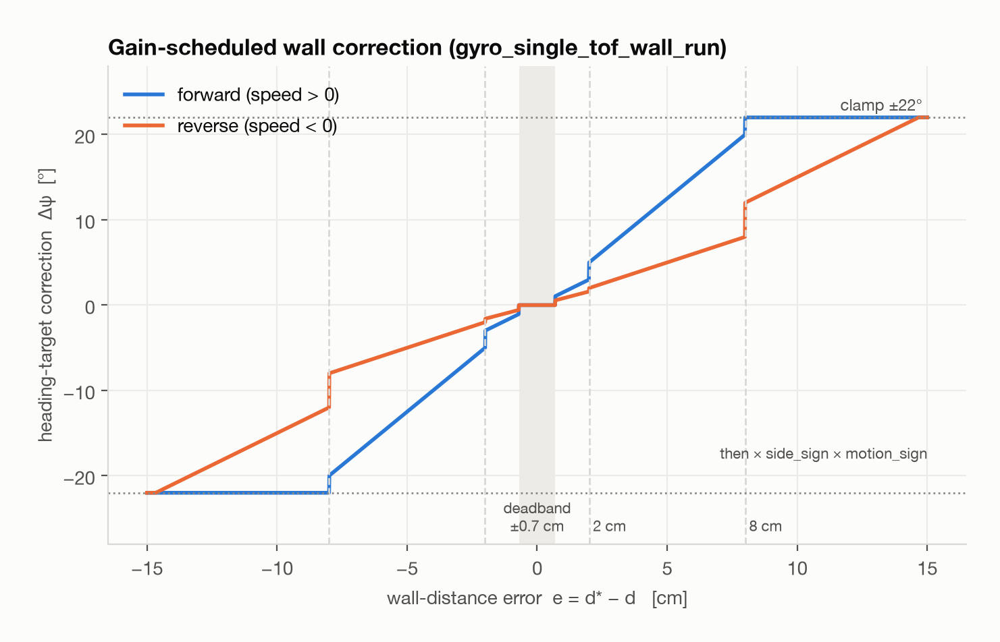</td>
<td>

**Why gain scheduling?** A single gain cannot handle both situations. With a high gain the
car oscillates around the target distance. With a low gain it takes too long to recover from
a big offset, for example after the 90° turn into the parking section. The scheduled gain
reacts strongly to large errors and gently near the target.
Forward and reverse use separately tuned gain sets (lower in reverse). All values were tuned
on the car and are fixed inside the function.

</td>
</tr>
</table>

### 6.5 Heading re-calibration against a wall

After three laps the integrated heading has drifted. Before parking, the car stops parallel
to a straight wall whose true heading it knows (e.g. $-1080^\circ$) and measures its own angle
to that wall with a side ToF pair:

<table>
<tr>
<td width="50%">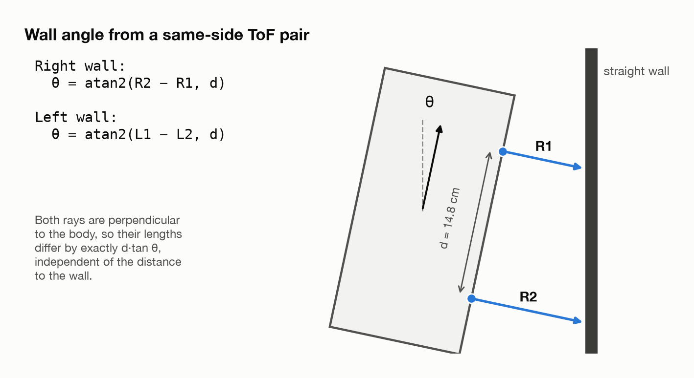</td>
<td>

```math
\theta_R = \mathrm{atan2}(R_2 - R_1,\ d),\qquad
\theta_L = \mathrm{atan2}(L_1 - L_2,\ d),\qquad d = 14.8\ \text{cm}
```

Both rays are perpendicular to the body, so $R_2 - R_1 = d\tan\theta$ holds exactly at any
distance from the wall. For every new frame $i$ a candidate offset is computed:

```math
\psi_{\text{off},i} = \psi_\text{off} + \big(\psi_\text{wall} + \theta_i - \psi_i\big)
```

</td>
</tr>
</table>

**Robust acceptance.** Per side, at least 8 valid frames (2 to 80 cm) out of 20, collected
within 2 s, are required. The new offset is the **median** of the candidates, and the side
is rejected if their standard deviation exceeds 6°. If both sides pass, the one with more
samples wins (then the one with lower spread). If neither side passes, the old offset is
kept. A bad measurement can therefore never make the heading worse.

### 6.6 Parallel parking

The wall run ends when the **leading** side ToF sees the parking-lot wall. That wall stands
inside the corridor, so the leading sensor suddenly reads much less than the trailing one:

```math
\text{stop if}\quad \text{gate open}\ \wedge\ \big(d_\text{trailing} - d_\text{leading}\big) \ge 15\ \text{cm}
```

The **gate** opens only after the trailing sensor has read within $d^{\ast} \pm 5$ cm for **3
consecutive frames**, which proves the car is actually running along the wall. The frame
that triggers the stop is never fed into the distance controller, so the parking wall
cannot cause a steering spike.

<details>
<summary><b>How the gate evolved (V03 → V05)</b></summary>

| Version | Gate condition | Problem found on the car |
|---|---|---|
| dual-ToF geometric | distance from $\tfrac{R_1+R_2}{2}\cos\theta$ within window | at large body angles the cos-correction compressed real 40–60 cm readings into the target window → false triggers |
| V04 (`gyro_wall_distance_run`) | reference ToF within ±5 cm **and** heading within ±5° | heading condition dropped in V05 (reason not recorded in the code, **TODO** confirm) |
| **V05 (current)** | reference ToF within ±5 cm for 3 consecutive frames | in use for competition |

The dual-ToF failure mode is documented in the docstring of `gyro_wall_distance_run`. Both
earlier functions are still in the library for comparison.

</details>

After detection, the manoeuvre is a fixed, mirrored sequence. It drives forward until the
right-rear ToF (R2, CCW case) reads under 15 cm, i.e. it is level with the parking-lot wall. Then it makes a reverse turn of 78°, reverses until the
back ToF reads 6 cm, then makes three open-loop moves (reverse with full steering, forward
with opposite steering, reverse again) limited by the front/back ToF and by wheel distance.

<p align="center">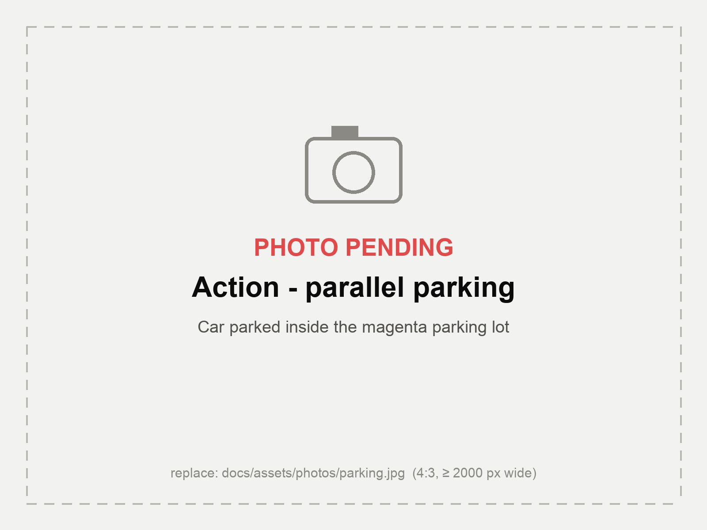</p>

### 6.7 AI pilot

<table>
<tr>
<td width="200" align="center">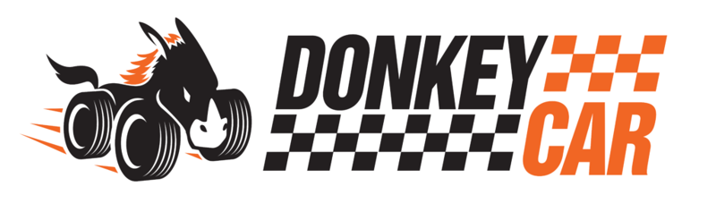<br>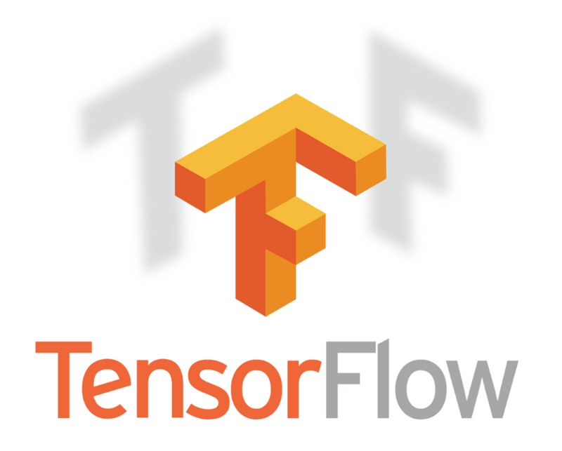</td>
<td>

- **Model:** DonkeyCar `KerasLinear`, a CNN regressing *(steering, throttle)* from one RGB frame
- **Input:** 160 × 120 × 3 (camera frame resized), identical camera settings in training and racing
- **Loop:** `ai_run` at 15 Hz; the measured loop rate and the worst-case inference time are logged every 5 s
- **Post-processing:** steering × 0.85 (`AI_RUN_ANGLE_OFFSET`); throttle × `max_speed` (0.35 / 0.70) as an execution limiter that leaves the model output untouched
- **Models:** one per direction and challenge, see [§7](#7-training-pipeline)

</td>
</tr>
</table>

Why separate CW and CCW models? A single model would have to learn that the same image
calls for opposite behaviour depending on the course direction. Two specialised models avoid
that conflict, and the start-line direction detection selects the right one. The recorded
data shows the expected asymmetry: CW runs mostly steer right, CCW runs mostly steer left
(§7).

<p align="right"><a href="#top">↑ back to top</a></p>

## 7. Training Pipeline

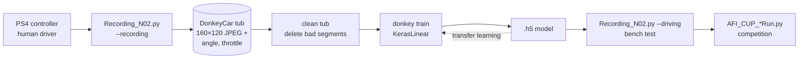

1. **Record.** `Recording_N02.py --recording` drives the car with a PS4 controller through
   the same DYNAMIXEL path as the competition code and writes every frame with the operator's
   steering and throttle into a DonkeyCar tub. `--color <name>` shows a live colour-area
   overlay for checking the lighting. It is display only, so the dataset format does not change.
2. **Clean.** Unwanted segments are marked as deleted in the tub (DonkeyCar
   `deleted_indexes`). Deleted frames are excluded from training and from every statistic below.
3. **Train** with DonkeyCar's trainer: one model per challenge and direction. The Open models
   are fine-tuned from earlier weights (*transfer learning*).
4. **Deploy.** Copy the `.h5` files to `~/Top WRO FE 2026/Models/` on the Pi.

<table>
<tr>
<td>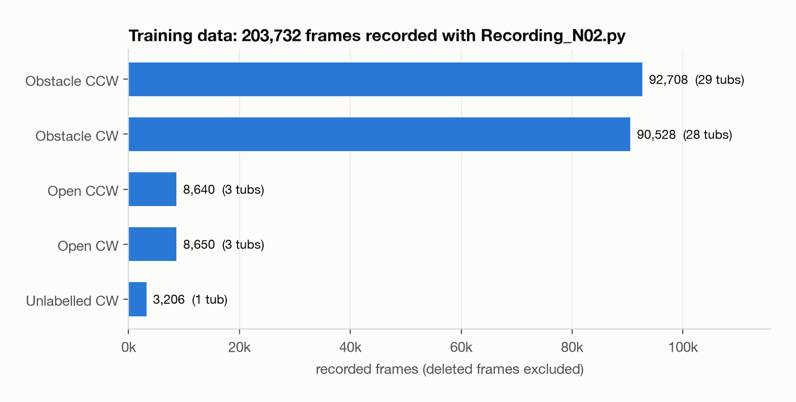</td>
<td>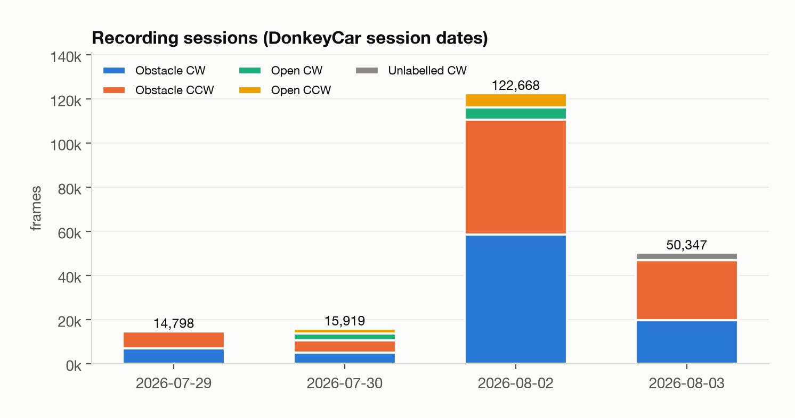</td>
</tr>
</table>

<p align="center">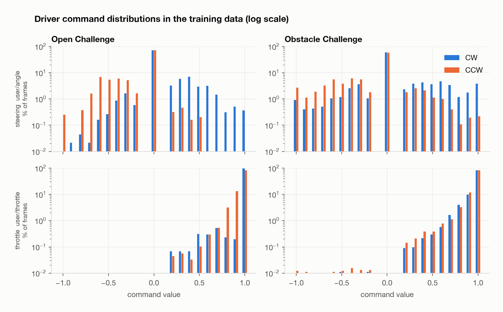</p>

**What the data tells us.** About 90% of the frames are Obstacle Challenge data. That
challenge has far more visual variety (pillar colours and positions), while the Open
Challenge only needs about 17k frames. The steering distributions are mirror images between
CW and CCW, which confirms that the two directions should get separate models. The throttle
is almost always at full command, because the speed is limited at run time
(`max_speed`), not by the driver.

**Competition models** (published as GitHub Release assets, not stored in git):

| Challenge | CW | CCW |
|---|---|---|
| Open | `TransferFcwmypilot.h5` | `TransferFccwmypilot.h5` |
| Obstacle | `ocw11mypilot.h5` | `occw10mypilot.h5` |

<p align="right"><a href="#top">↑ back to top</a></p>

## 8. Testing and Validation

| Test | Tool | Result |
|---|---|---|
| Sensor hub stream, ToF rates | [`pico_hub_test.py`](src/pi5/tools/pico_hub_test.py) + `stats` | **TODO**: record measured Hz per sensor |
| DYNAMIXEL health and recovery | [`dxl_recover_test.py`](src/pi5/tools/dxl_recover_test.py) | **TODO** |
| Steering range and centre | [`steer_45_test.py`](src/pi5/tools/steer_45_test.py) | **TODO**: measured wheel angle at ±1 |
| Drive motor | [`spin_motor2.py`](src/pi5/tools/spin_motor2.py) | **TODO**: rpm under load |
| Camera exposure | [`camera_view.py`](src/pi5/tools/camera_view.py), [`line_color_detect.py`](src/pi5/tools/line_color_detect.py) | **TODO** |
| Open Challenge runs | `AFI_CUP_FRun.py` | **TODO**: success rate over N runs, lap times |
| Obstacle Challenge runs | `AFI_CUP_ORun.py` | **TODO**: success rate, parking success |
| Heading drift after 3 laps | `calibrate_gyro_from_side_wall` log | **TODO**: offset correction per run |

The AI loop logs its measured frequency and inference times on the car (`[ai_run PERF]` lines).
Those logs will be added here as plots.

<p align="right"><a href="#top">↑ back to top</a></p>

## 9. Engineering Journal

<p align="center">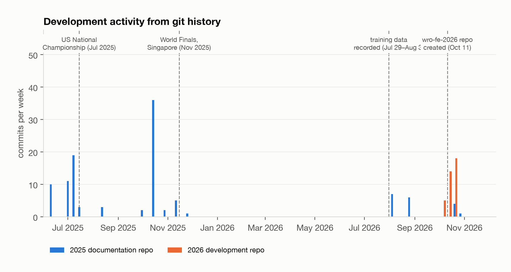</p>

| When | Milestone |
|---|---|
| Jul 2025 | **US National Champions** with V1.0 (Pi 4, RC motor + servo, WT901 gyro) |
| Nov 2025 | **World Finals, Singapore** with V2.0 (Pi 5 + Build HAT LEGO motors, Sense HAT IMU, 4 × VL53L0X) |
| Jul 29 – Aug 3 2026 | 203,732 training frames recorded in four sessions |
| Oct 2026 | Pico 2 sensor-hub firmware restructured in three iterations (Oct 11 → 25); DYNAMIXEL bench tools and recovery added |
| Oct 2026 | Colour-sampling tools, `Recording_N02` with colour overlay, `pico_hub_test` |

The full decision log (problem → options → decision → result) is in
[`docs/engineering-journal.md`](docs/engineering-journal.md).

<p align="right"><a href="#top">↑ back to top</a></p>

## 10. Build and Reproduce

**Bill of materials**

| # | Part | Qty | Role |
|---|---|---|---|
| 1 | [Raspberry Pi 5](https://www.raspberrypi.com/products/raspberry-pi-5/) | 1 | main computer |
| 2 | [Raspberry Pi Pico 2](https://www.raspberrypi.com/products/raspberry-pi-pico-2/) | 1 | sensor hub |
| 3 | [ROBOTIS DYNAMIXEL XL330-M288-T](https://emanual.robotis.com/docs/en/dxl/x/xl330-m288/) | 2 | drive (ID 1), steering (ID 2) |
| 4 | [ROBOTIS U2D2](https://emanual.robotis.com/docs/en/parts/interface/u2d2/) | 1 | USB ↔ TTL bus adapter |
| 5 | ST VL53L4CX ToF breakout | 1 | front distance |
| 6 | ST VL53L4CD ToF breakout | 5 | side and rear distances |
| 7 | BNO085 IMU breakout (UART-RVC) | 1 | heading |
| 8 | TCS34725 colour sensor with LED | 1 | floor colour |
| 9 | Raspberry Pi camera (CSI), model **TODO** | 1 | vision |
| 10 | Raspberry Pi Sense HAT | 1 | joystick and LED user interface |
| 11 | Battery, regulators, switch, fuse | **TODO** | power |
| 12 | Chassis parts | **TODO** | see [`models/`](models) |

**Software setup**

```bash
# Raspberry Pi 5 (Raspberry Pi OS 64-bit)
python3 -m venv ~/env && source ~/env/bin/activate
pip install -r src/pi5/requirements.txt

# Pico 2: flash MicroPython for RP2350, then copy the hub firmware
mpremote cp src/pico2/*.py :
mpremote reset
python3 src/pi5/tools/pico_hub_test.py        # check the 20 Hz stream (no motors)

# Models: download the four .h5 files from the GitHub Release into
#   ~/Top WRO FE 2026/Models/
```

**Run.** Place the car, start the script and confirm the direction on the Sense HAT joystick:

```bash
cd src/pi5/competition
python3 AFI_CUP_FRun.py        # Open Challenge       ⚠ motors move
python3 AFI_CUP_ORun.py        # Obstacle Challenge   ⚠ motors move
```

> [!WARNING]
> Lift the wheels off the table before any test that moves the motors. Before you run the
> competition scripts with the current Pico firmware, apply and test the two-line
> serial-protocol adapter described in [`docs/software.md`](docs/software.md#23-compatibility-note-the-pi-parser-needs-an-adapter).

<p align="right"><a href="#top">↑ back to top</a></p>

## 11. Repository Structure

```text
.
├── README.md            ← this document
├── t-photos/            team photos (official + fun)
├── v-photos/            six vehicle views + bottom
├── video/video.md       performance video links
├── schemes/             topology, pinout, sensor layout, control loop (PNG + SVG)
├── models/              3D / CAD files of the chassis parts
├── src/
│   ├── pi5/             Raspberry Pi 5 code (competition, data collection, tools)
│   └── pico2/           Pico 2 MicroPython sensor-hub firmware
├── docs/
│   ├── software.md          threads, serial protocol, motion primitives
│   ├── engineering-journal.md
│   ├── photo-checklist.md   photos still to be taken
│   ├── open-items.md        measurements still missing
│   ├── data/                JSON summaries behind the charts
│   └── assets/              figures, photos, component images
└── tools/figures/       scripts that regenerate every figure
```

Every figure can be rebuilt with `python3 tools/figures/make_all.py`
(see [`tools/figures/make_all.py`](tools/figures/make_all.py)).

<p align="right"><a href="#top">↑ back to top</a></p>

## 12. Lessons Learned and Next Steps

**Lessons**

1. **Let the learned and the deterministic parts each do what they are good at.** The CNN is
   good at varied scenes. Gyro and ToF control are better at anything that needs centimetres
   or degrees.
2. **Bound the influence of every sensor.** The ToFs move a clamped heading target instead of
   steering directly. A bad reading costs a few degrees, not a crash.
3. **One owner per bus.** With all serial traffic in one thread, two threads can never
   interleave packets on the same port, by construction.
4. **Calibrate against the world, not against time.** Re-zeroing the heading on a known wall
   removes three laps of drift within a 2-second measurement window.

**Next steps**

- Apply and validate the serial-protocol adapter (labelled frames, `reset` command).
- Use the TCS34725 floor-colour stream as an independent lap and section counter.
- Measure and publish the power budget, success rates and ToF refresh rates.
- Merge the Open and Obstacle library variants into one file with a configuration switch.

<p align="right"><a href="#top">↑ back to top</a></p>

## 13. License and Acknowledgements

Released under the [MIT License](LICENSE).

- [DonkeyCar](https://www.donkeycar.com/) for the camera, tub and Keras pilot framework
- Adafruit's VL53L4CD CircuitPython driver (MIT) and the MicroPython `I2CDevice` port by
  blobbybilb & BvngeeCord (MIT), used in [`src/pico2/`](src/pico2)
- ROBOTIS [DYNAMIXEL SDK](https://github.com/ROBOTIS-GIT/DynamixelSDK)
- Repository structure inspired by previous WRO Future Engineers teams, notably
  [ejm22/WRO-FE-XX](https://github.com/ejm22/WRO-FE-XX) and
  [KMIDS-GFM](https://github.com/Chayanon-Ninyawee/KMIDS-GFM-Future-Engineer-2025)

<p align="right"><a href="#top">↑ back to top</a></p>
