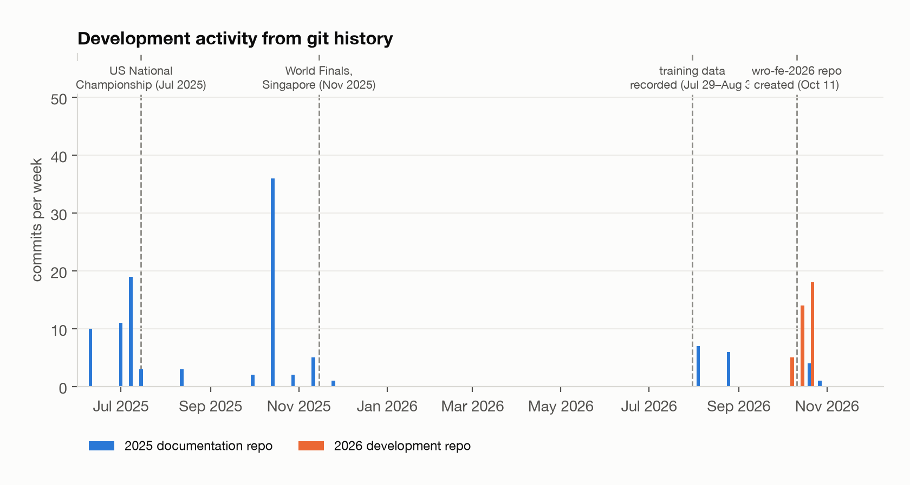

# Engineering Journal

[← back to README](../README.md)

This journal records **what changed, why, and what the evidence was**. Every entry points to
the code where the decision lives. Where the reason for a change was not written down at the
time, the entry says so; we do not reconstruct reasons after the fact.

## 1. Where we started: the 2025 season

| | V1.0, US Nationals (Jul 2025) | V2.0, World Finals Singapore (Nov 2025) |
|---|---|---|
| Computer | Raspberry Pi 4 | Raspberry Pi 5 + Build HAT |
| Drive / steering | RC brushed motor + ESC, RC servo via PCA9685 | LEGO Technic motors on the Build HAT |
| Heading | WT901 gyroscope | Sense HAT IMU with ZUPT drift correction |
| Distance | 1 × ToF | 4 × VL53L0X (front / right / back / left) |
| Driving | DonkeyCar CNN | DonkeyCar CNN + gyro / ToF scripted parking |

Source: [Top_WRO-2025-documentation](https://github.com/TopWRO/Top_WRO-2025-documentation).
We won Nationals with V1.0. V2.0 traded speed for stability.

## 2. Decision log, 2026 season

### D1: DYNAMIXEL XL330 servos replace LEGO motors
- **Before.** In 2025 the car drove with LEGO Technic motors on a Raspberry Pi Build HAT.
- **Decision.** Two XL330-M288-T on one TTL bus (U2D2): ID 1 in velocity mode drives, ID 2 in
  position mode steers.
- **What it provides.** Closed-loop speed in the motor, a 4096-count absolute encoder used as odometry
  (`UnifiedRobotIO._update_position`), and hardware-error reporting with automatic
  reboot/reconfigure at start-up (`recover_and_configure_dynamixel`).
- **Cost.** The XL330 is small, so the drive is geared up 1 : 3 (`DXL_WHEEL_REVS_PER_MOTOR_REV`).

### D2: Sensors move to a Pico 2 co-processor
- **Before.** In 2025 the ToF sensors (GPIO XSHUT, I2C) and the Sense HAT IMU were read
  directly by Python code on the Pi, alongside camera capture and CNN inference.
- **Decision.** A Pico 2 runs all sensor timing in MicroPython and streams one frame per
  50 ms over USB. Core 1 owns the ToF bus. Core 0 owns USB, the IMU and the colour sensor.
- **Evolution.** The firmware went through three versions between Oct 11 and Oct 25, 2026.
  The final one (`src/pico2/main.py`, `sensor_hub_tof.py`) is split into an entry file and a
  ToF worker module, uses a lock-protected mailbox, has run-time timing-budget commands and a
  `stats` self-test.

### D3: Six ToF sensors with paired sides
- **Decision.** F (VL53L4CX) and B, plus **two sensors per side** (R1/R2, L1/L2) 14.8 cm apart.
- **Why pairs.** One side sensor measures distance. Two measure the wall angle as well
  ($\theta=\mathrm{atan2}(R_2-R_1,d)$), which makes heading re-calibration possible (D6).
- **Trade-off.** Strict round-robin ranging (one emitter at a time) means about 3.7 Hz per
  sensor. The controllers therefore filter, hold the last value over short dropouts, and use
  the gyro for the fast loop (D5).

### D4: One I/O thread owns every port
- **Problem.** Steering and throttle used to run in separate threads that shared one U2D2
  `PortHandler` (see the note on `DynamixelSteering`: "no longer creates its own thread").
- **Decision.** `UnifiedRobotIO`: a single 20 Hz thread reads the Pico, writes steering,
  writes velocity and reads position. Its inputs are latest-value mailboxes, with no queue.
- **Result.** Two threads can never interleave packets on a bus, and stale commands are
  never replayed.

### D5: ToF moves the heading target, never the steering
- **Decision.** In every wall-following primitive the ToF error becomes a **clamped heading
  offset**. The heading P-controller is the only thing that steers
  (`gyro_single_tof_wall_run`, the "only attitude target is the gyro target" comment).
- **Why.** A ToF spike, for example when the parking-lot wall comes into view, can bend the
  heading target by at most 22°. It can never produce a full-lock steering command.
- **Tuning.** Gain scheduling: 1.5 / 2.5 / 4.0 °/cm forward and 0.8 / 1.0 / 1.5 °/cm reverse
  for errors < 2 / 2–8 / ≥ 8 cm, with a 0.7 cm deadband, tuned on the car.

### D6: Re-zero the heading against a straight wall before parking
- **Problem.** After three laps (±1080°) the integrated heading has drifted, which ruins the
  90° turns of the parking manoeuvre.
- **Decision.** `calibrate_gyro_from_side_wall(wall_angle)` measures the body-to-wall angle
  with a side pair and corrects a global software offset. It uses the median of up to 20
  frames, rejects sides with σ > 6°, and leaves the offset unchanged on failure.
- **Use.** Called twice in the Obstacle run, at −1170° and −1080° (CCW).
- **Asymmetric scale.** Separately, the raw heading is scaled by 1.00 (CW) / 1.01 (CCW)
  (`gyro_offset_cw`, `gyro_offset_ccw`).

### D7: Parking-wall detection gate, three iterations
| Version | Function | Gate | Outcome |
|---|---|---|---|
| dual-ToF | `gyro_dual_tof_wall_follow_run` | perpendicular distance from both side ToFs | at large body angles, the cos() correction squeezed real 40–60 cm readings into the target window → false detections (documented in `gyro_wall_distance_run`) |
| V04 | `gyro_wall_distance_run` | reference ToF ±5 cm **and** heading ±5° | heading condition removed in V05; reason **TODO** (not recorded) |
| V05 | `gyro_single_tof_wall_run` | reference ToF ±5 cm for 3 consecutive frames; stop when trailing − leading ≥ 15 cm | competition version |

### D8: Separate CW / CCW models and a run-time throttle limiter
- **Decision.** Four networks (Open / Obstacle × CW / CCW), selected by the start-line
  direction detection. The model's throttle output is multiplied by `max_speed`
  (0.70 Open, 0.35 Obstacle) instead of re-recording data at a different speed.
- **Evidence.** The steering distributions of the 203,732 recorded frames are mirror images
  between CW and CCW (README §7).

### D9: Competition flow split into library + run scripts
- **Decision.** `AFI_CUP_V05*.py` contain only reusable primitives. `AFI_CUP_ORun.py` and
  `AFI_CUP_FRun.py` contain only the challenge sequence (`run_program`), and CW is a line-by-line
  mirror of CCW.
- **Why.** Tuning between runs touches a ~150-line file instead of a ~2900-line one.

## 3. Open issues

- The Pi parser still expects the legacy 7-field frame and sends `reset gyro`. The adapter is
  documented in [`software.md`](software.md#23-compatibility-note-the-pi-parser-needs-an-adapter).
- The TCS34725 floor-colour data is streamed but not yet used.
- Measured results (success rates, power, ToF rates) still need to be recorded; see
  [`open-items.md`](open-items.md).
