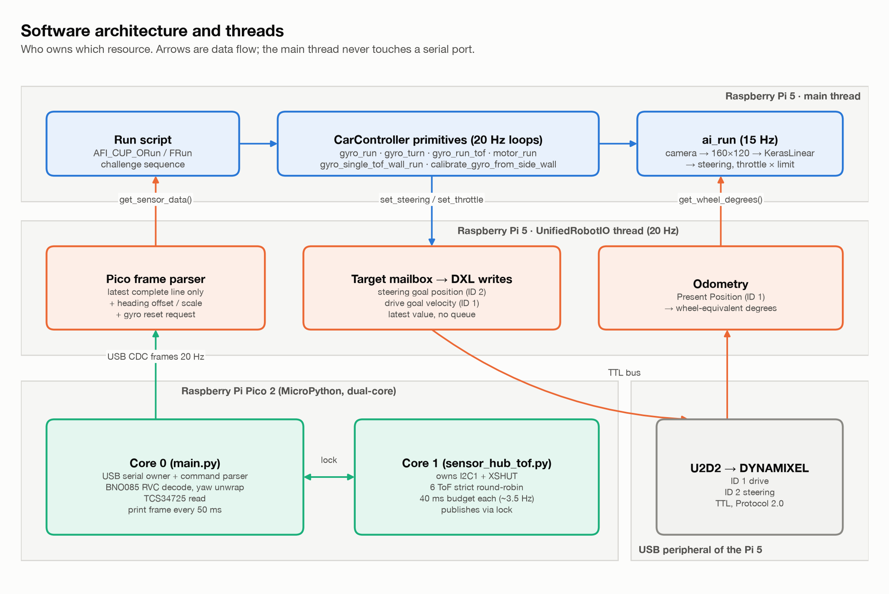
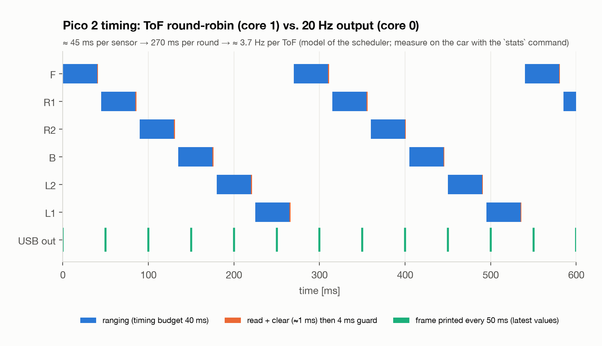

# Software Architecture

[← back to README](../README.md)

This document describes how the code in [`src/`](../src) is organised at run time: which
thread owns which resource, how the Raspberry Pi 5 and the Pico 2 talk to each other, and
what the motion primitives guarantee. The algorithms themselves are derived in the main
[README § Obstacle Management](../README.md#6-obstacle-management).

<p align="center"></p>

## 1. Execution model

| Context | Rate | Owns | Talks to others via |
|---|---|---|---|
| Pi 5 main thread: run script + `CarController` | 20 Hz control loops, 15 Hz `ai_run` | camera, CNN | `UnifiedRobotIO.set_*()` / `get_*()` under locks |
| Pi 5 `UnifiedRobotIO` thread | 20 Hz, absolute-time ticks | Pico USB serial (`/dev/ttyACM0`), U2D2 bus (`/dev/ttyUSB0`) | latest-value mailboxes, sensor snapshot with `frame_seq` |
| Pico 2 core 0 (`main.py`) | 20 Hz output | USB CDC, UART0 (BNO085), I2C0 (TCS34725) | `HubShared` lock |
| Pico 2 core 1 (`sensor_hub_tof.py`) | ~3.7 Hz per ToF (round-robin) | I2C1 + 6 XSHUT lines | `HubShared` lock |

**Design rules that came out of the 2025 season:**

1. **One owner per port.** Earlier versions gave steering and throttle their own threads,
   both sharing one U2D2 `PortHandler`. In 2026, only `UnifiedRobotIO` touches the Pico and
   the U2D2, so two threads can never interleave packets on the same bus. On the Pico, only
   core 0 touches USB.
2. **Latest value, no queue.** Steering and throttle targets are single variables, never
   queues. When the main loop is late, the robot executes the newest command instead of
   replaying stale ones.
3. **Absolute-time scheduling.** Every loop computes `next_tick += dt`. An overrun does not try
   to catch up; the schedule restarts from "now".
4. **Fail safe.** Every primitive ends with throttle 0. `main()` always calls
   `car.shutdown()` in a `finally:` block. DYNAMIXEL faults are recovered (reboot +
   reconfigure) only at start-up, never while the car is moving.

<p align="center"></p>

The six ToF sensors range strictly one at a time. All six share one I2C bus, and ranging
them one by one also avoids optical cross-talk. The cost is a refresh rate of about 3.7 Hz
per sensor, while the USB output runs at 20 Hz and repeats the latest value. The motion
code allows for this by low-pass filtering (EMA, α = 0.5) and by holding the last valid
correction for up to 0.5 s.

## 2. Serial protocol

### 2.1 Pico 2 → Pi 5 (current firmware, `src/pico2/main.py`)

One line every 50 ms, 115200 baud nominal (USB CDC):

```text
degree=-12.3,F=45.0,R1=26.1,R2=25.8,B=-1.0,L2=80.2,L1=79.9,C1R=812,C1G=903,C1B=640,C1C=2410
```

| Field | Unit | Meaning |
|---|---|---|
| `degree` | ° | continuous (unwrapped) BNO085 yaw since the last `reset`; `nan` = no IMU frame for 2 s |
| `F`, `R1`, `R2`, `B`, `L2`, `L1` | cm | ToF distance; `-1` = no valid reading, `-2` = sensor disabled |
| `C1R`, `C1G`, `C1B`, `C1C` | counts | TCS34725 red, green, blue, clear (24 ms integration, 4× gain) |

Lines that start with `#` are status messages (`# INIT`, `# OK`, `# ERR`, `# STATS`).

### 2.2 Pi 5 → Pico 2 commands

| Command | Effect |
|---|---|
| `reset` | zero the heading (applied at the next fresh IMU frame; replies `# OK reset: degree=0.0`) |
| `F:40`, `Front:40`, `R1:0`, … | set one ToF's timing budget in ms (`0` disables it, otherwise 10 to 200) |
| `stats` | print a 10-second refresh-rate report for every ToF |

### 2.3 Compatibility note: the Pi parser needs an adapter

The competition library (`AFI_CUP_V05*.py`) was written against an earlier firmware and does
not yet speak the current protocol. There are two differences:

| | Pi 5 code (`UnifiedRobotIO`) expects | Current Pico firmware sends / accepts |
|---|---|---|
| Sensor frame | 7 unlabelled numbers `gyro,F,R1,R2,B,L2,L1` | 11 labelled fields `degree=…,F=…,…,C1C=…` |
| Heading reset | sends `reset gyro` | accepts exactly `reset` (other text → `# ERR`) |

Until it is adapted, `_read_latest_serial_frame()` rejects every line, because
`float("degree=…")` fails, and the gyro is never zeroed. The adapter needs only two small
edits. **They are documented here and have not yet been applied to the competition code.**
They must be tested on the car before any run.

```python
# 1) in UnifiedRobotIO._read_latest_serial_frame(), replace the CSV parsing with:
FIELDS = ("degree", "F", "R1", "R2", "B", "L2", "L1")

def parse_labelled_frame(text):
    """'degree=..,F=..,...' -> [gyro, F, R1, R2, B, L2, L1], or None if unusable."""
    if text.startswith("#"):
        return None
    kv = dict(item.split("=", 1) for item in text.split(",") if "=" in item)
    try:
        nums = [float(kv[k]) for k in FIELDS]
    except (KeyError, ValueError):
        return None
    if nums[0] != nums[0]:          # degree=nan -> no IMU data, skip the frame
        return None
    return nums

# 2) in UnifiedRobotIO._handle_gyro_reset_if_requested():
self.ser.write(b"reset\n")          # was b"reset gyro\n"
```

The rest of the pipeline is unchanged: the sign flip, the CW/CCW scale factors and the
software heading offset. One thing must be checked on the car: rotate it clockwise by hand
and confirm that the Pi's `angle` increases. The firmware's yaw sign convention has to be
checked again whenever the IMU mounting changes.

## 3. Motion primitives (`CarController`)

All primitives run at 20 Hz on top of the I/O snapshots, use the continuous heading
(clockwise positive, so three CCW laps = −1080°) and stop the drive motor when they finish.
"Distance" is measured in **wheel-equivalent degrees**: drive-motor encoder × 3 (the 1:3
gear-up).

| Primitive | Steering law | Stops on | Used in |
|---|---|---|---|
| `gyro_run` | $u = 0.01\,(\psi^{\ast} - \psi)$ | time, distance | lap finish, parking approach |
| `gyro_turn` | constant command | heading crosses target, timeout | unpark, parking turns |
| `gyro_run_tof` | PID (0.015, 0, 0.005) + near-wall target shift | ToF < threshold, time, distance | parking-section approach |
| `gyro_single_tof_wall_run` | cascade (see README §6.4) | parking wall detected, time, distance | final wall run before parking |
| `calibrate_gyro_from_side_wall` | none (car stationary) | samples collected or 2 s | heading re-zero after the laps |
| `motor_run` | constant command, open loop | ToF threshold, time, distance | final parking wiggle |
| `ai_run` | CNN output × 0.85 | heading ≥ ±1060…1080° | the three laps |

## 4. Start-up sequence

1. Open `/dev/ttyACM0` (Pico) and `/dev/ttyUSB0` (U2D2). Each DYNAMIXEL goes through
   *check error → reboot if needed → torque off → set mode → profile → torque on*.
2. Start the `UnifiedRobotIO` thread and command steering to centre and velocity to 0.
3. Open the camera with locked exposure and white balance (DonkeyCar `PiCamera` part).
4. `detect_run_clockwise()`: reset the gyro and compare L1 and R1 → suggest CW or CCW on the
   Sense HAT LEDs. A long press on the joystick toggles the choice; releasing it confirms.
5. Load the CW or CCW model for the challenge, build `CarController` and run the sequence.

## 5. Dependencies

See [`src/pi5/requirements.txt`](../src/pi5/requirements.txt). The Pico runs stock
MicroPython for RP2350 and needs only the files in [`src/pico2/`](../src/pico2), copied flat
to the board's root.
