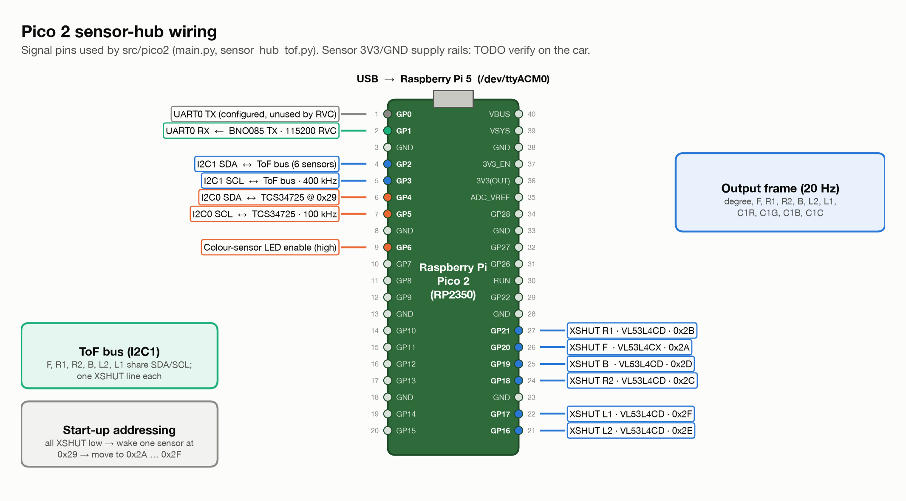

# Electromechanical Diagrams

All diagrams are generated from the source code by
[`tools/figures/make_all.py`](../tools/figures/make_all.py). SVG files are vector and can be
zoomed without loss.

| Diagram | PNG | SVG | Content |
|---|---|---|---|
| System topology | [png](system_topology.png) | [svg](system_topology.svg) | every board, sensor and actuator with its interface |
| Pico 2 wiring / pinout | [png](pico_wiring_pinout.png) | [svg](pico_wiring_pinout.svg) | every used Pico pin, ToF addresses and XSHUT lines |
| Sensor layout and FoV | [png](sensor_layout_fov.png) | [svg](sensor_layout_fov.svg) | ToF positions and roles (schematic, not to scale) |
| Control cascade | [png](control_cascade.png) | [svg](control_cascade.svg) | wall-distance / heading control loop |

**Pending:** a power-distribution schematic (battery, regulators, switch, fuse). See
[`docs/open-items.md`](../docs/open-items.md) H5 / H8.

