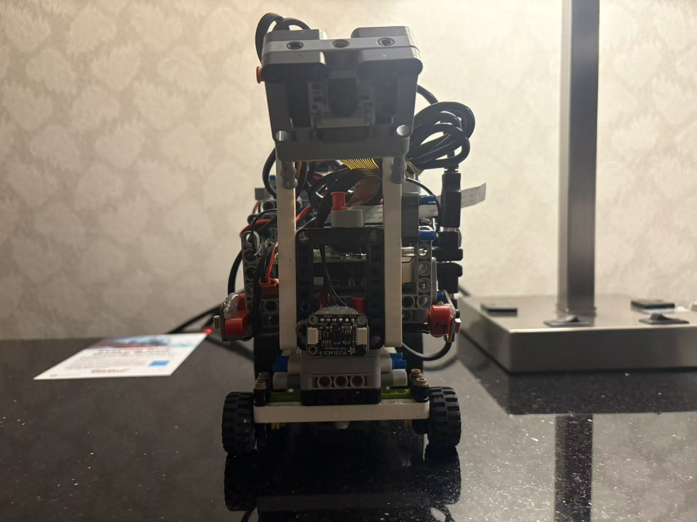
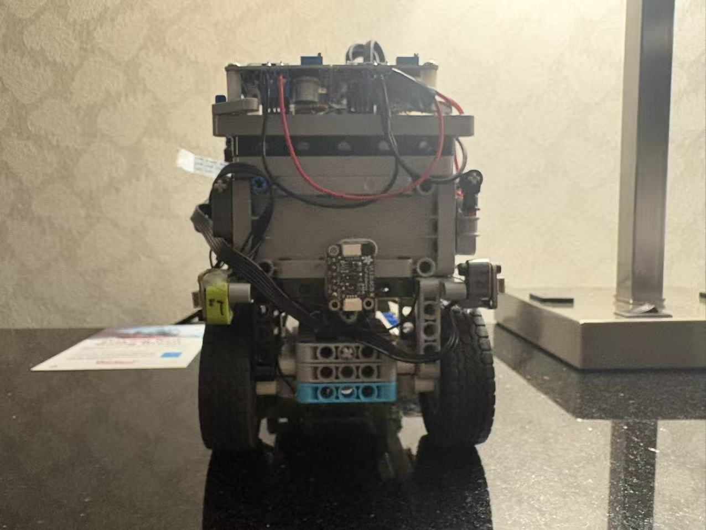
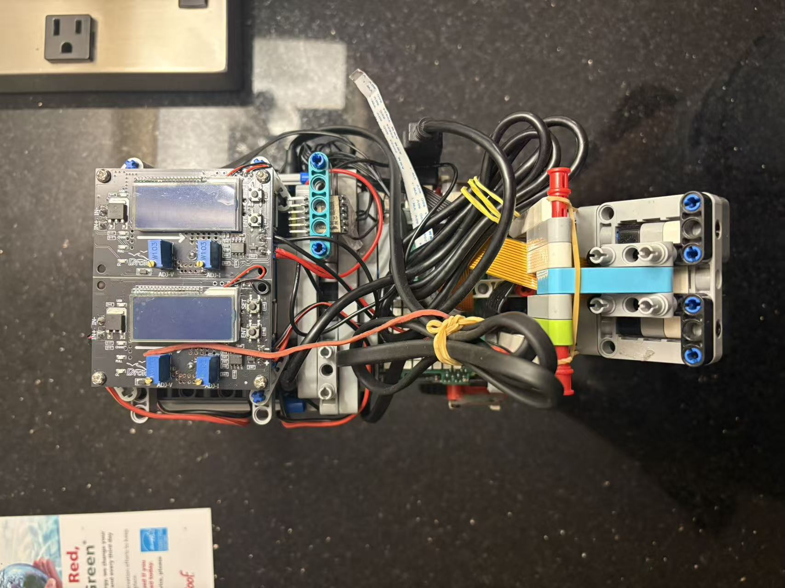
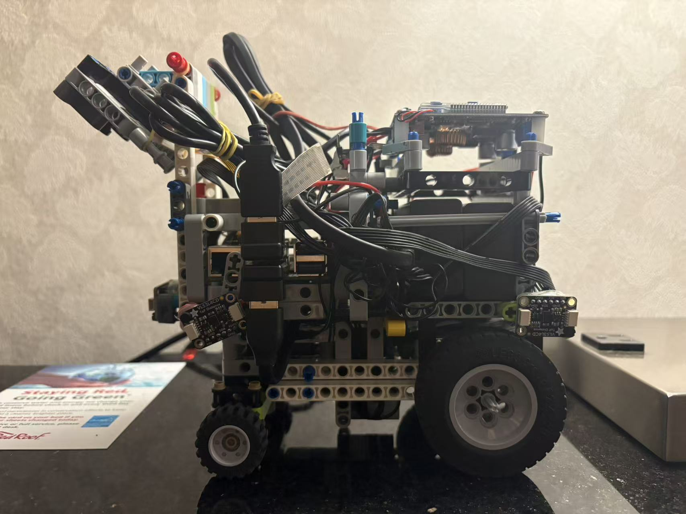
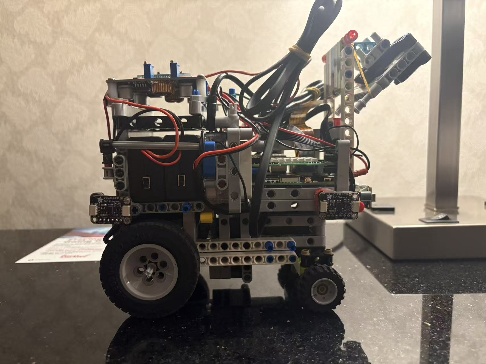

# Vehicle Photos

Six views plus the underside, as required by the WRO Future Engineers rules.

| Front | Back | Top |
|:---:|:---:|:---:|
|  |  |  |
| **Left** | **Right** | **Bottom** |
|  |  |  |

The files are currently **placeholders**. Shot specifications are in
[`docs/photo-checklist.md`](../docs/photo-checklist.md).
